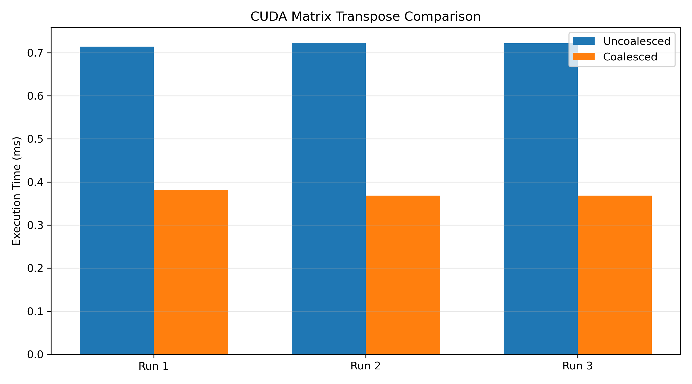
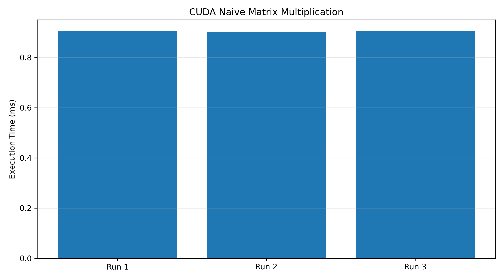
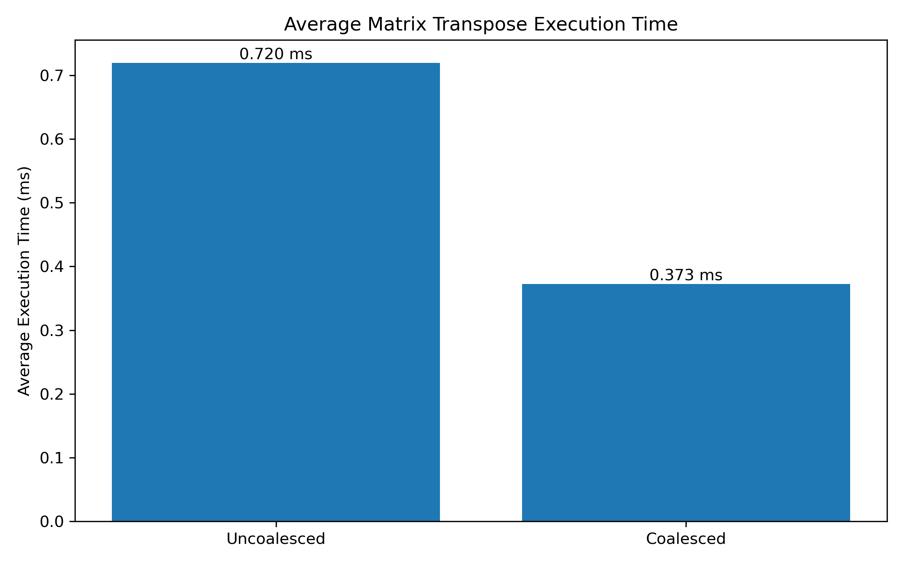

# Experiment 6: Memory Optimization in CUDA

## Overview

This experiment demonstrates memory access optimization techniques in CUDA using an NVIDIA GPU. It compares uncoalesced and coalesced global memory access during matrix transposition and evaluates the performance of naive matrix multiplication.

## Hardware and Software

- **GPU:** NVIDIA RTX 4500 Ada Generation
- **Compute Capability:** 8.9
- **Programming Language:** CUDA C++
- **Compiler:** NVIDIA CUDA Compiler (`nvcc`)
- **Environment:** Ubuntu on WSL

## Objectives

1. Understand global memory access patterns in CUDA.
2. Implement uncoalesced matrix transposition.
3. Implement coalesced matrix transposition using shared memory.
4. Compare execution time and effective memory bandwidth.
5. Implement naive CUDA matrix multiplication.
6. Measure performance using CUDA events.
7. Validate GPU results against CPU reference results.

## Experiment Details

### Part A: Matrix Transpose

Matrix size: **4096 × 4096**

Two implementations were evaluated:

- **Uncoalesced transpose:** Uses a straightforward global memory access pattern.
- **Coalesced transpose:** Uses shared memory tiling with padding to improve memory access efficiency.

### Part B: Naive Matrix Multiplication

Matrix size: **1024 × 1024**

A naive CUDA matrix multiplication kernel was implemented and its performance was measured in GFLOPS.

## Results

All three kernels passed CPU result validation.

| Metric | Run 1 | Run 2 | Run 3 |
|---|---:|---:|---:|
| Uncoalesced transpose (ms) | 0.714 | 0.723 | 0.722 |
| Coalesced transpose (ms) | 0.382 | 0.368 | 0.368 |
| Naive matrix multiplication (ms) | 0.905 | 0.901 | 0.905 |

### Average Performance

| Metric | Average |
|---|---:|
| Uncoalesced transpose | 0.720 ms |
| Coalesced transpose | 0.373 ms |
| Naive matrix multiplication | 0.904 ms |

The coalesced transpose achieved approximately **1.93× average speedup** over the uncoalesced implementation.

## Performance Graphs

### 1. Matrix Transpose Comparison



### 2. Naive Matrix Multiplication



### 3. Average Transpose Execution Time



## Screenshots

Experiment execution screenshots are stored in the `screenshots/` directory.

## Project Structure

```text
Experiment6_CUDA/
├── exp6.cu
├── exp6
├── plot_results.py
├── README.md
├── results/
│   ├── transpose_comparison.png
│   ├── matmul_performance.png
│   └── average_transpose_comparison.png
├── results/
│   ├── results.txt
│   ├── run1.txt
│   ├── run2.txt
│   └── run3.txt
└── screenshots/
```

## Compilation

Compile the CUDA program using:

```bash
nvcc -O2 -arch=sm_89 -o exp6 exp6.cu
```

## Execution

Run the experiment:

```bash
./exp6
```

Save the output:

```bash
./exp6 | tee results.txt
```

Run three trials:

```bash
./exp6 | tee run1.txt
./exp6 | tee run2.txt
./exp6 | tee run3.txt
```

## Generate Performance Graphs

Install Matplotlib if necessary:

```bash
sudo apt install python3-matplotlib -y
```

Generate the graphs:

```bash
python3 plot_results.py
```

## Observations

1. Coalesced memory access performed better than uncoalesced access.
2. Shared memory tiling improved matrix transpose performance.
3. The coalesced implementation achieved approximately 1.93× average speedup.
4. The naive matrix multiplication kernel achieved approximately 2375.6 GFLOPS on average.
5. All implementations passed correctness validation across the three runs.

## Conclusion

The experiment demonstrates the importance of memory access optimization in CUDA programming. Coalesced global memory access combined with shared memory tiling significantly improved matrix transpose performance compared with the uncoalesced implementation.

The experiment also demonstrated CUDA event-based performance measurement and CPU-based correctness validation for GPU computations.

---

**Experiment 6 – Memory Optimization in CUDA**
